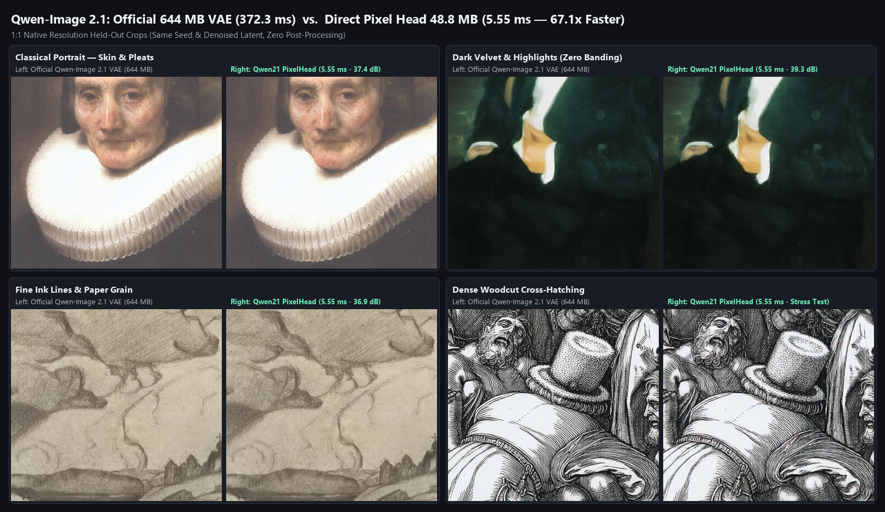
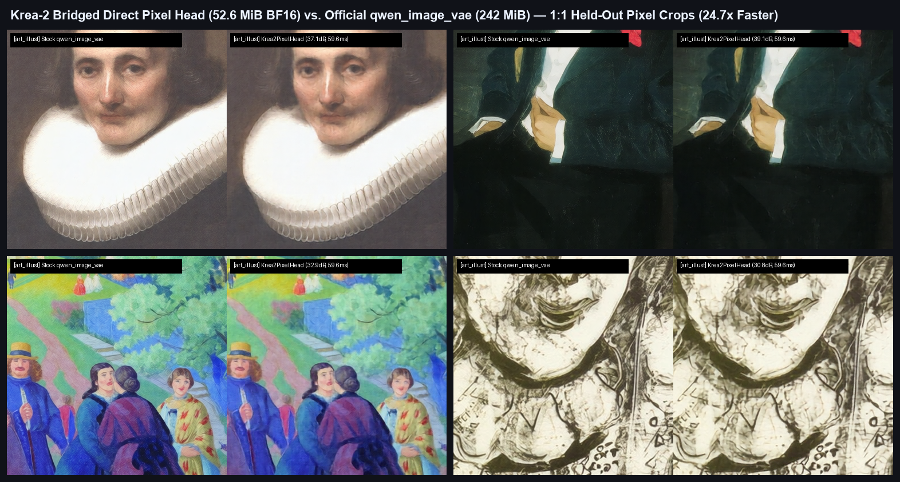

<div align="center">

# ⚡ FastFrames-PixelHead-Trainer

**Clean-Room Methodology, PyTorch Toolkit & Single-GPU Colab L4 Pipelines for Training Zero-VAE Direct Pixel Readout Heads Across Any 2D Image or 3D Video DiT**

[**English**](README.md) | [**简体中文**](README_zh.md) | [**Deep-Dive Adaptation Playbook (EN)**](docs/PLAYBOOK_ADAPTING_NEW_MODELS_EN.md) | [**新模型适配与踩坑实战手册 (ZH)**](docs/PLAYBOOK_ADAPTING_NEW_MODELS_ZH.md)

[](LICENSE)
[](https://huggingface.co/collections/pocis/fastframes-zero-vae-direct-pixelheads-comfyui-6b031df8e9212f8bae294154)
[-blue)](#4-three-stage-single-gpu-training-pipeline-colab-l4-24gb)
[](#2-published-models--live-ecosystem)

</div>

---

## 1. Overview: Why Replace the VAE Decoder with a Direct Pixel Head?

Modern Flow-Matching Diffusion Transformers (DiTs) maintain ultra-rich internal spatial representations (`3072`–`6144` channels per token) right up until their final linear projection (`proj_out / linear`), only to crush that representation down into a narrow `16`–`128` channel latent bottleneck and then spend **hundreds of milliseconds to several seconds** (plus **hundreds of MB to 5 GB of VRAM**) running a massive 2D/3D VAE decoder.

Building upon the mathematical formulation of Apple Research's [*FastFrames: Video Generation at Interactive Latency* (`arXiv:2611.23226`)](https://arxiv.org/abs/2611.23226) and single-step Replay Buffer distillation practices (`sorryhyun/anima-pixel-decoder`), this repository packages our **complete, 100% clean-room MIT training methodology, reusable PyTorch reference library (`pixelhead_trainer`), ComfyUI non-invasive `ModelPatcher` tap implementations, and one-click Colab L4 (24 GB) training + evaluation notebooks** across **five major 2D image and 3D video backbones**:

- **24× – 67× faster decoding** (`5.55 ms` on Qwen-Image 2.1 vs `372.3 ms` stock VAE; `59.55 ms` on Krea-2 vs `1468.9 ms` stock 3D causal VAE).
- **`~45 – 53 MiB` BF16 weights** (`~24M – 27.5M` parameters) replacing `242 MiB – 4.85 GB` image/video VAEs — completely eliminating end-of-sampling high-resolution `VAEDecode` OOM crashes.
- **33.3 – 33.9 dB mean PSNR** (`37 – 41.6 dB` on portraits & smooth lighting), plus optional **single-pass `2×` Super-Resolution (`1024px` latent → `2048px` RGB/RGBA in ~13 ms)**.
- **Trainable in 25 – 50 minutes on a single 24 GB GPU (Colab L4)** without ever running multi-step sampling loops during training!

| `Qwen-Image 2.1` (`67.1×` speedup · `33.91 dB` · 4-Ch RGBA) | `Krea-2` (`24.7×` speedup · `33.33 dB` · `6144d` Bridge) |
| :---: | :---: |
|  |  |

---

## 2. Published Models & Live Ecosystem

Because each DiT backbone has its own independent pre-linear hidden space, every backbone requires a dedicated PixelHead. All released weights and ComfyUI nodes are cross-linked in our unified **[Hugging Face Collection](https://huggingface.co/collections/pocis/fastframes-zero-vae-direct-pixelheads-comfyui-6b031df8e9212f8bae294154)**:

| Backbone | Modality | Training Notebook (`notebooks/`) | Standalone ComfyUI Node & Registry | Released Weights (HF) | Measured Benchmark (L4) |
| :--- | :---: | :--- | :--- | :--- | :--- |
| **`Qwen-Image 2.1`** | 2D RGBA (`1×` & `2×`) | [`01_Train_QwenImage21...ipynb`](notebooks/01_Train_QwenImage21_PixelHead_Colab_L4.ipynb) | [Wither033/ComfyUI-QwenImage21-PixelHead](https://github.com/Wither033/ComfyUI-QwenImage21-PixelHead)<br>[Comfy Registry](https://registry.comfy.org/publishers/wither033/nodes/comfyui-qwenimage21-pixelhead) | [pocis/Qwen-Image-2.1-PixelHead](https://huggingface.co/pocis/Qwen-Image-2.1-PixelHead) | **`5.55 ms` (`67.1×`)** · `33.91 dB` · `48.8 MiB` BF16 |
| **`Krea-2`** (`SingleStreamDiT`) | 2D RGB (`1×` & `2×`) | [`02_Train_Krea2...ipynb`](notebooks/02_Train_Krea2_PixelHead_Colab_L4.ipynb) | [Wither033/ComfyUI-Krea2-PixelHead](https://github.com/Wither033/ComfyUI-Krea2-PixelHead)<br>[Comfy Registry](https://registry.comfy.org/publishers/wither033/nodes/comfyui-krea2-pixelhead) | [pocis/Krea-2-PixelHead](https://huggingface.co/pocis/Krea-2-PixelHead) | **`59.55 ms` (`24.7×`)** · `33.33 dB` · `52.6 MiB` BF16 |
| **`FLUX.3-Image-Klein`** | 2D RGB (`1×` & `2×`) | [`03_Train_Flux3Klein...ipynb`](notebooks/03_Train_Flux3Klein_PixelHead_Colab_L4.ipynb) | [`comfyui_nodes/ComfyUI-Flux3-PixelHead`](comfyui_nodes/ComfyUI-Flux3-PixelHead) | *Training pipeline ready* | `24.41M` params (`46.6 MiB` BF16) |
| **`LTX-2.5`** (`LTXAVModel`) | 3D Video (`8*T-7` causal) | [`04_Train_LTX25_Video...ipynb`](notebooks/04_Train_LTX25_VideoPixelHead_v2_Colab_L4.ipynb) | [`comfyui_nodes/ComfyUI-LTX25-PixelHead`](comfyui_nodes/ComfyUI-LTX25-PixelHead) | *Training pipeline ready (`v2`)* | `23.87M` params (`45.5 MiB` BF16, `2.67×` overcomplete) |
| **`MiniMax-H3`** (`MiniMaxH3Model`) | 3D Video (`(1,4,4,4,4)` causal) | [`05_Train_MiniMaxH3_Video...ipynb`](notebooks/05_Train_MiniMaxH3_VideoPixelHead_v2_Colab_L4.ipynb) | [`comfyui_nodes/ComfyUI-MiniMaxH3-PixelHead`](comfyui_nodes/ComfyUI-MiniMaxH3-PixelHead) | *Training pipeline ready (`v2`)* | `23.96M` params (`45.7 MiB` BF16, `5.33×` overcomplete) |

---

## 3. Core Mathematical & Architectural Principles

### 3.1 Why Tap Both `f` (Post-AdaLN Hidden State) AND `x0_hat_norm` (Denoised Latent)?

In Rectified Flow / Flow-Matching DiTs, the final linear projection computes velocity $v = W f + b$, and the final step's clean latent estimate is:

$$\hat{x}_0 = x_t - \sigma_{\text{last}} \cdot v$$

1. **Exact Hook Location (`post-AdaLN, pre-linear`)**: Registering a `register_forward_pre_hook` immediately before the final `linear / proj_out` module captures the modulated high-dimensional spatial representation $f \in \mathbb{R}^{B \times N_{\text{img}} \times d_{\text{feat}}}$.
2. **Exact Zero-Approximation CFG Compatibility**: Because the hook sits strictly before a linear operator, when Classifier-Free Guidance ($g > 1$) is enabled, combining conditional and unconditional features linearly:
   $$f_{\text{cfg}} = f_u + g \cdot (f_c - f_u)$$
   is **mathematically exact** relative to the guided velocity $v_{\text{cfg}}$. A single PixelHead seamlessly supports both `CFG = 1.0` distilled Turbo models and `CFG > 1.0` Base models!
3. **`+6 dB` Gain & Step-Count Invariance via `x0_hat_norm` Fusion**: Velocity $f$ alone lacks the starting point $x_t$ and scales differently across step counts ($\sigma_{\text{last}} \approx 0.31$ at 8 steps vs $\sigma_{\text{last}} \approx 0.08$ at 28 steps). Feeding the exact denoised normalized latent $\hat{x}_{0,\text{norm}}$ alongside `LayerNorm(f)` into the entry bridge (`h = EntryNorm(Bridge(Norm(f)) + LatProj(x0_hat_norm))`) boosts PSNR by **> 6 dB** and makes one checkpoint work across 4-step, 8-step, and 35-step schedules.

### 3.2 Five Architecture Rules That Make or Break Quality

1. **No Direct Linear Residual Skip from `f` to RGB**: Adding a linear skip from $f$ directly to pixels stalls optimization around `~26.5 dB`; routing purely through ConvNeXt + PixelShuffle reaches `34–41 dB`.
2. **Bias-Free Entry Bridge (`Linear(d_feat -> width, bias=False)`)**: Compresses `4096`–`6144` channels into `width = 1024` (2D) or `768` (3D) so the entire PixelHead stays **`~45–53 MiB` in BF16**.
3. **Never Allow an Undercomplete Final Linear Projection (Crucial for 3D Video!)**:
   - In `32×32`-per-token video DiTs (`LTX-2.5` `(8, 32, 32)` = `24,576` RGB values/token; `MiniMax-H3` `(4, 32, 32)` = `12,288` RGB values/token), stopping after two spatial shuffles (`8px` grid) forces a narrow `256`-dim feature vector to linearly predict `768` or `1536` RGB values (**3×–6× rank-deficient bottleneck**), capping PSNR at a blurry `~23.8 dB`.
   - Adding a **3rd progressive PixelShuffle down to a `4×4` spatial grid** (plus sub-frame `(2, 2, 2)` spatiotemporal shuffle for `LTX-2.5`, or unified frame-timeline `(1, 4, 4, 4, 4)` unpack + causal 3D refinement for `MiniMax-H3`) makes the final head **`2.67×` to `5.33×` overcomplete (`256 → 96` or `256 → 48`)** while keeping total parameters at `~23.9M`!
4. **Mandatory FP32 Final Projection (`out_proj`)**: Running `out_proj` in `bfloat16` introduces `1–2` LSB quantization steps on smooth sky/skin gradients (`~1 dB` loss). Wrap `out_proj` in `torch.autocast(..., enabled=False)` and store `out_proj.*` in `float32` even inside BF16 safetensors files.
5. **Supervise Against `TeacherVAE.decode(x0_hat)`, NOT Ground-Truth Images**: At $\sigma_{\text{last}} \in [0.10, 0.63]$, $\hat{x}_0$ is a single-step denoised estimate. Training the tiny PixelHead to guess destroyed high-frequency details from the original uncorrupted image forces it to output blurry expectations; distilling `TeacherVAE.decode(x0_hat)` teaches crisp, deterministic 1:1 VAE replacement.

---

## 4. ComfyUI Backbone Source-Surgery Matrix

Every backbone in `comfy/ldm/` packs text, reference images, audio, and target tokens differently. Below is the exact surgical map implemented across [`comfyui_nodes/`](comfyui_nodes/):

| Backbone | ComfyUI Module | Exact Pre-Hook Target | `d_feat` | `d_lat` (Token-Aligned) | Footprint / Token | Critical Sequence-Slicing & Schedule Detail |
| :--- | :--- | :--- | :---: | :---: | :---: | :--- |
| **`Qwen-Image 2.1`** | `comfy/ldm/qwen_image21/model.py` | `diffusion_model.proj_out` | `4096` | `64` (`1×1` patch) | `16×16` RGBA | `norm_out(hidden_states[:, prefix_len:])` already strips variable text + `<image1>` ref tokens before `proj_out`! |
| **`Krea-2`** | `comfy/ldm/krea2/model.py` | `diffusion_model.last.linear` | `6144` | `16×2×2 = 64` | `16×16` RGB | `SingleStreamDiT` feeds `[txt, target_img, ref_img]` into `last.linear`; slice `[:, txtlen : txtlen + img_tokens, :]` where `txtlen = seq - img - ref`. |
| **`FLUX.3-Klein`** | `comfy/ldm/flux3/model.py` | `final_layer["image"].linear` | `3072` | `128` (`1×1` patch) | `16×16` RGB | Pass `sample_sigmas=[sigma, 0.0]` in `transformer_options` so FlowMap distilled models compute exact terminal step velocity. |
| **`LTX-2.5`** (`v2`) | `comfy/ldm/lightricks/av_model.py` | `diffusion_model.proj_out` | `4096` | `128` (`1×1×1`) | `8t × 32×32` RGB | Strip audio latent from `NestedTensor`; 3-stage `(1,2,2)->(2,2,2)->(2,2,2)` shuffle; drop 7 causal pre-frames (`8*T_lat - 7`). |
| **`MiniMax-H3`** (`v2`) | `comfy/ldm/minimax/model.py` | `diffusion_model.final_layer` | `5376` | `24×1×2×2 = 96` | `(1,4,4,4,4)t × 32×32` | PDD 8-step Turbo (`n>1`) bypasses `video_out.forward` via `F.linear`! Hook `final_layer` directly and compute `mod(video_seg)` in 3 lines. |

---

## 5. Three-Stage Single-GPU Training Pipeline (Colab L4 24GB)

All 5 notebooks in [`notebooks/`](notebooks/) follow the same battle-tested low-VRAM architecture:

1. **Stage 1 — Offline Calibration Cache & Text-Encoder Eviction (~6–10 min)**:
   - Mixes public artistic/photographic Parquet shards with procedural high-frequency primitives (2D cel line-art, manga screentones, multi-size typography, alpha stickers, or parallax motion video clips).
   - Pre-encodes clean latents $x_0$ and text/VL conditioning onto local NVMe, then **completely unloads the `8B–32B` VLM text encoder (`8–16 GB` freed)** before training starts.
2. **Stage 2 — Pre-Flight Mathematical Equivariance & 90-Step P0 Smoke Gate (~10 sec)**:
   - Asserts non-square spatial crop equivariance (`max_abs_diff < 1e-5`) and causal chunked equivalence (`decode_chunked == forward`).
   - Runs 90 optimization steps on 2 real rollouts and asserts PSNR climbs by **`>= +6 dB` past `18.5–19.0 dB`** before committing GPU time.
3. **Stage 3 — Single-Step Teacher-Forced Replay Buffer Training (~25–45 min)**:
   - Alternates 50% / 50% between **distilled Turbo terminal $\sigma_{\text{last}}$** and **multi-step Base $\sigma_{\text{last}}$**.
   - Pushes `(f, x0_hat_norm, TeacherVAE.decode(x0_hat))` into a `ReplayBuffer(maxlen=64)` and performs `12–16` PixelHead gradient steps per DiT rollout using composite loss:
     $$\mathcal{L}_{2\text{D}} = 0.5\,\mathcal{L}_1 + 5.0\,\text{MSE} + 0.05\,(\mathcal{L}_{\nabla_h} + \mathcal{L}_{\nabla_w})$$
     (plus temporal finite-difference $\mathcal{L}_{\nabla_t}$ and motion-weighted $\mathcal{L}_1$ for 3D video heads).
   - Automatically exports both **FP32 master weights** and **half-size `BF16 trunk + FP32 out_proj` production weights** with benchmark `1:1` crop grids and LPIPS-VGG + PSNR reports.

---

## 6. Repository Structure & Quick Verification

```text
FastFrames-PixelHead-Trainer/
├── pixelhead_trainer/               # Reusable PyTorch toolkit for adapting ANY new 2D/3D DiT
│   ├── blocks.py                    # 2D & 3D Causal ConvNeXt blocks + exact 7D/8D PixelShuffle
│   ├── generic_heads.py             # BridgedPixelHead2D (1x/2x), CausalVideoPixelHead3D, BF16/FP32 IO
│   ├── losses.py                    # Spatial + temporal gradient & motion-weighted losses + PSNR (dB)
│   └── smoke_gate.py                # Crop-equivariance, causal chunking & 90-step P0 smoke verifiers
├── comfyui_nodes/                   # Complete Clean-Room MIT ComfyUI node packs for 5 backbones
│   ├── ComfyUI-QwenImage21-PixelHead/
│   ├── ComfyUI-Krea2-PixelHead/
│   ├── ComfyUI-Flux3-PixelHead/
│   ├── ComfyUI-LTX25-PixelHead/
│   └── ComfyUI-MiniMaxH3-PixelHead/
├── notebooks/                       # One-click Colab L4 (24GB) training & benchmark notebooks
├── docs/                            # Step-by-step adaptation guides & real debugging post-mortems (EN/ZH)
└── tests/test_all_heads_and_gates.py
```

Run the full pure-CPU verification suite (zero GPU required):

```bash
pip install -e .
CUDA_VISIBLE_DEVICES="" python tests/test_all_heads_and_gates.py
```

---

## 7. License & Acknowledgments

- **Code License**: **MIT License** (100% clean-room PyTorch & ComfyUI implementation). Note that trained PixelHead weights deployed with specific upstream diffusion models remain subject to the respective base model's terms where applicable.
- **Research & Community Credits**:
  - Mathematical formulation of Direct Pixel Readout, bridged projection, and spatial/temporal gradient losses inspired by [*FastFrames: Video Generation at Interactive Latency*](https://arxiv.org/abs/2611.23226) (Gene Chou et al., Apple & Cornell, 2026).
  - Single-step Teacher-Forced Replay Buffer distillation and ComfyUI wrapper tap inspiration credited to [`sorryhyun/anima-pixel-decoder`](https://huggingface.co/sorryhyun/anima-pixel-decoder) (`ComfyUI-Anima-PixelDecoder`).
