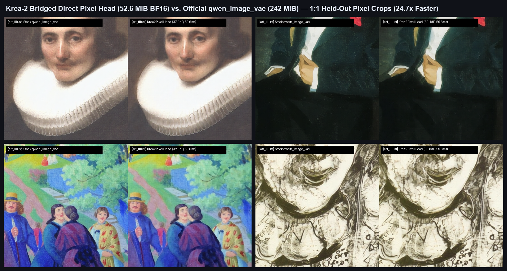

<div align="center">

# ⚡ FastFrames-PixelHead-Trainer

**免 VAE 极速像素直出头（Direct Pixel Head）全底座通用训练方法论、PyTorch 工具包与单卡 Colab L4 一键训练管线（支持 2D 图像 & 3D 因果视频）**

[**English**](README.md) | [**简体中文**](README_zh.md) | [**新模型 5 步适配与踩坑实战手册 (ZH)**](docs/PLAYBOOK_ADAPTING_NEW_MODELS_ZH.md) | [**Deep-Dive Playbook (EN)**](docs/PLAYBOOK_ADAPTING_NEW_MODELS_EN.md)

[](LICENSE)
[](https://huggingface.co/collections/pocis/fastframes-zero-vae-direct-pixelheads-comfyui-6b031df8e9212f8bae294154)
[-blue)](#5-%E5%8D%95%E5%8D%A1-colab-l4-24gb-%E4%B8%89%E6%AE%B5%E5%BC%8F%E6%9E%81%E9%80%9F%E8%AE%AD%E7%BB%83%E6%B5%81%E6%B0%B4%E7%BA%BF)
[](#2-%E5%B7%B2%E5%BC%80%E6%BA%90%E6%A8%A1%E5%9E%8B%E4%B8%8E%E4%BA%94%E5%A4%A7%E5%BA%95%E5%BA%A7%E7%9F%A9%E9%98%B5)

</div>

---

## 1. 为什么要为扩散模型训练专属 PixelHead（彻底扔掉 VAE 解码器）？

现代流匹配扩散模型（DiT）在内部最后一层其实拥有高达 **`3072 ~ 6144` 维**的丰富空间语义特征；然而传统生成流程却在最后一步强行把它压扁成仅 `16 ~ 128` 通道的潜变量，然后再花**数百毫秒乃至数秒时间、额外占用数百 MB 到近 5 GB 显存**去跑庞大的 2D/3D VAE 解码器——这也是 `1024~2048px` 高分辨率出图或长视频生成**在进度条 99% 最后一步爆显存（OOM）**的头号元凶。

受 Apple Research 论文 [*FastFrames* (`arXiv:2611.23226`)](https://arxiv.org/abs/2611.23226) 直接像素读出数学形式与社区单步重放蒸馏实践（`sorryhyun/anima-pixel-decoder`）启发，本仓库将我们**从零独立推导编写（100% Clean-Room MIT）的全底座通用训练框架 `pixelhead_trainer`、5 大主流图像/视频底座源码级拆解方案、ComfyUI 无侵入特征截获节点以及单卡 Colab L4（24GB）一键训练评测 Notebook** 完整开源：

- **解码提速 `24× ~ 67×`**：`Qwen-Image 2.1` 从官方 VAE 的 `372.3 ms` 降至 **`5.55 ms`（快 67.1 倍）**；`Krea-2` 从 3D 因果 VAE 的 `1468.9 ms` 降至 **`59.55 ms`（快 24.7 倍）**。
- **仅 `~45 ~ 53 MiB`（BF16）超轻体积**：直接替代 `242 MiB ~ 4.85 GB` 的传统图像/视频 VAE，文生图与文生视频全程零 VAE 显存占用。
- **肉眼无损级还原（均值 `33.3 ~ 33.9 dB PSNR`）**：人像与柔光场景高达 **`37.1 ~ 41.6 dB`**，并支持挂载二阶超分分支，在 `~13 ms` 内将 `1024px` 潜空间**一步直出 `2048px` 高清 RGB / RGBA**。
- **单张 24GB 显卡（Colab L4）25 ~ 50 分钟训完**：无需在训练期跑慢速多步采样循环！

| `Qwen-Image 2.1`（提速 `67.1×` · 均值 `33.91 dB` · 原生 4 通道 RGBA） | `Krea-2`（提速 `24.7×` · 均值 `33.33 dB` · `6144d` 降维桥） |
| :---: | :---: |
|  |  |

---

## 2. 已开源模型与五大底座矩阵

由于不同 DiT 底座末层隐藏态的特征空间彼此独立，每个底座都需要训练专属的 PixelHead。所有已发布权重均聚合于 **[Hugging Face 官方合集](https://huggingface.co/collections/pocis/fastframes-zero-vae-direct-pixelheads-comfyui-6b031df8e9212f8bae294154)**：

| 适配底座 | 模态规格 | 一键训练 Notebook (`notebooks/`) | 独立 ComfyUI 插件仓 & 注册表 | Hugging Face 权重仓 | L4 实测基准 / 规格 |
| :--- | :---: | :--- | :--- | :--- | :--- |
| **`Qwen-Image 2.1`** | 2D RGBA (`1×` & `2×`) | [`01_Train_QwenImage21...ipynb`](notebooks/01_Train_QwenImage21_PixelHead_Colab_L4.ipynb) | [Wither033/ComfyUI-QwenImage21-PixelHead](https://github.com/Wither033/ComfyUI-QwenImage21-PixelHead)<br>[Comfy Registry](https://registry.comfy.org/publishers/wither033/nodes/comfyui-qwenimage21-pixelhead) | [pocis/Qwen-Image-2.1-PixelHead](https://huggingface.co/pocis/Qwen-Image-2.1-PixelHead) | **`5.55 ms` (`67.1×`)** · `33.91 dB` · `48.8 MiB` BF16 |
| **`Krea-2`** (`SingleStreamDiT`) | 2D RGB (`1×` & `2×`) | [`02_Train_Krea2...ipynb`](notebooks/02_Train_Krea2_PixelHead_Colab_L4.ipynb) | [Wither033/ComfyUI-Krea2-PixelHead](https://github.com/Wither033/ComfyUI-Krea2-PixelHead)<br>[Comfy Registry](https://registry.comfy.org/publishers/wither033/nodes/comfyui-krea2-pixelhead) | [pocis/Krea-2-PixelHead](https://huggingface.co/pocis/Krea-2-PixelHead) | **`59.55 ms` (`24.7×`)** · `33.33 dB` · `52.6 MiB` BF16 |
| **`FLUX.3-Image-Klein`** | 2D RGB (`1×` & `2×`) | [`03_Train_Flux3Klein...ipynb`](notebooks/03_Train_Flux3Klein_PixelHead_Colab_L4.ipynb) | [`comfyui_nodes/ComfyUI-Flux3-PixelHead`](comfyui_nodes/ComfyUI-Flux3-PixelHead) | *训练台已就绪* | `24.41M` 参数 (`46.6 MiB` BF16) |
| **`LTX-2.5`** (`LTXAVModel`) | 3D 视频 (`8*T-7` 因果) | [`04_Train_LTX25_Video...ipynb`](notebooks/04_Train_LTX25_VideoPixelHead_v2_Colab_L4.ipynb) | [`comfyui_nodes/ComfyUI-LTX25-PixelHead`](comfyui_nodes/ComfyUI-LTX25-PixelHead) | *v2 训练台已就绪* | `23.87M` 参数 (`45.5 MiB` BF16，`2.67×` 过完备) |
| **`MiniMax-H3`** (`MiniMaxH3Model`) | 3D 视频 (`(1,4,4,4,4)` 因果) | [`05_Train_MiniMaxH3_Video...ipynb`](notebooks/05_Train_MiniMaxH3_VideoPixelHead_v2_Colab_L4.ipynb) | [`comfyui_nodes/ComfyUI-MiniMaxH3-PixelHead`](comfyui_nodes/ComfyUI-MiniMaxH3-PixelHead) | *v2 训练台已就绪* | `23.96M` 参数 (`45.7 MiB` BF16，`5.33×` 过完备) |

---

## 3. 核心数学原理与架构黄金铁律

### 3.1 为什么必须同时输入 `f`（末层调制特征）与 `x0_hat_norm`（去噪潜变量）？

在流匹配（Flow Matching）DiT 中，末层线性头预测的是速度场 $v = W f + b$，而最后一步还原出的干净潜变量估计为：

$$\hat{x}_0 = x_t - \sigma_{\text{last}} \cdot v$$

1. **挂点铁律（`AdaLN` 调制之后、末层 `linear / proj_out` 之前）**：在此处注册 `register_forward_pre_hook`（注意钩子函数必须返回 `None`！），即可无损拿到全部高维语义与边缘纹理特征 $f$。
2. **零近似完美兼容 CFG**：由于挂点紧贴在线性映射之前，当开启 `CFG > 1`（引导尺度 $g$）时，直接对正负向特征做线性合成：
   $$f_{\text{cfg}} = f_u + g \cdot (f_c - f_u)$$
   在数学上与引导速度场 $v_{\text{cfg}}$ **严格等价**！因此同一个 PixelHead 权重天然通吃 `CFG = 1.0`（8步蒸馏 Turbo）与 `CFG > 1.0`（25~50步精修 Base）。
3. **融合 `x0_hat_norm` 带来 `+6 dB` 飞跃并消除步数敏感性**：仅靠速度特征 $f$ 缺少起点信息且随总步数变化剧烈；将归一化后的 `f` 与干净潜变量估计 `x0_hat_norm` 在入口相加归一化（`EntryNorm(Bridge(Norm(f)) + LatProj(x0_hat_norm))`），PSNR 直接跃升 **6 dB 以上**，且单文件跨步数通用。

### 3.2 决定成败的五条黄金设计准则（含真实踩坑结论）

1. **严禁加 `f -> RGB` 的直接线性残差跳连**：实测加线性直通会让训练卡死在 `~26.5 dB`；纯走 ConvNeXt + PixelShuffle 主干才能冲上 `34 ~ 41 dB`。
2. **超大隐藏维先过无偏置降维桥 `Linear(d_feat -> width, bias=False)`**：即便底模隐藏维高达 `5376` 或 `6144`，也能把整个头稳定压在 **`~45 ~ 53 MiB`（BF16）**。
3. **末层投影必须「过完备」（3D 高倍率视频头头号避坑点！）**：
   - 在单 Token 覆盖 `32×32` 像素的视频 DiT（如 `LTX-2.5` 每 Token `8×32×32×3 = 24,576` 个值、`MiniMax-H3` 每 Token `4×32×32×3 = 12,288` 个值）中，若只做两级 `PixelShuffle` 到 `8px` 网格，末层就会变成 `256 -> 1536` 或 `256 -> 768` 的**严重欠完备降秩瓶颈**，画质封死在模糊的 `~23.8 dB`。
   - **解法（`v2` 架构）**：必须做**三级渐进 `PixelShuffle` 到 `4×4` 像素网格**（配合 `LTX-2.5` 的 `(2,2,2)` 时空重排，或 `MiniMax-H3` 的 `(1,4,4,4,4)` 统一帧时间轴展开 + 跨帧因果 3D 精修），让末层变成 **`256 -> 96`（`2.67×` 过完备）或 `256 -> 48`（`5.33×` 过完备）**，总参数量反而仅 `~23.9M`！
4. **最后一层 `out_proj` 强制锁定 `FP32`**：主干跑 `BF16` 飞快，但最后一层 `Linear -> RGB` 若用 `BF16` 会在暗部与人像皮肤上产生 `1~2` 色阶断层并掉 `~1 dB`；必须用 `torch.autocast(..., enabled=False)` 强制 `FP32` 计算与存储。
5. **监督目标必须是 `TeacherVAE.decode(x0_hat)`，绝不能直接拟合原图 `x_raw`**：单步去噪后的 $\hat{x}_0$ 已丢失部分极高频噪声信息，强迫小头去猜原图里不可知的细节只会逼它输出模糊平均值；拟合官方 Teacher VAE 对同一 $\hat{x}_0$ 的解码结果，才能学出刀锋般锐利的 1:1 替代器。

> 更详细的 **「任意新模型 10 分钟 5 步解剖流程」与「5 个真实 Bug 复盘」** 请直接阅读 **[docs/PLAYBOOK_ADAPTING_NEW_MODELS_ZH.md](docs/PLAYBOOK_ADAPTING_NEW_MODELS_ZH.md)**。

---

## 4. ComfyUI 五大底座源码挂点速查表

| 底座模型 | ComfyUI 源码文件 | Pre-Hook 精确挂载模块 | `d_feat` | `d_lat` | 单 Token 像素覆盖 | 序列切片与蒸馏调度关键细节 |
| :--- | :--- | :--- | :---: | :---: | :---: | :--- |
| **`Qwen-Image 2.1`** | `comfy/ldm/qwen_image21/model.py` | `diffusion_model.proj_out` | `4096` | `64` | `16×16` RGBA | `norm_out(hidden_states[:, prefix_len:])` 在进 `proj_out` 前已自动剥离文本与 `<image1>` 参考图前缀！ |
| **`Krea-2`** | `comfy/ldm/krea2/model.py` | `diffusion_model.last.linear` | `6144` | `16×2×2=64` | `16×16` RGB | 单流序列 `[txt, target_img, ref_img]` 整体进 `last.linear`，需按 `txtlen = seq - img - ref` 精准切片目标图像段。 |
| **`FLUX.3-Klein`** | `comfy/ldm/flux3/model.py` | `final_layer["image"].linear` | `3072` | `128` | `16×16` RGB | 训练前向需在 `transformer_options` 传入 `sample_sigmas=[sigma, 0.0]` 以激活 FlowMap 蒸馏末步推理分支。 |
| **`LTX-2.5`** (`v2`) | `comfy/ldm/lightricks/av_model.py` | `diffusion_model.proj_out` | `4096` | `128` | `8t × 32×32` RGB | 从音画 `NestedTensor` 解绑视频流；三级 3D 时空重排后裁掉前 7 帧因果预热帧（精确对齐 `8*T_lat - 7`）。 |
| **`MiniMax-H3`** (`v2`) | `comfy/ldm/minimax/model.py` | `diffusion_model.final_layer` | `5376` | `24×1×2×2=96` | `(1,4,4,4,4)t × 32×32` | 8步 PDD 蒸馏模型绕过了 `video_out.forward` 直接调 `F.linear`！必须在 `final_layer` 入口挂载并用 3 行代码复现 `mod(video_seg)`。 |

---

## 5. 单卡 Colab L4（24GB）三段式极速训练流水线

[`notebooks/`](notebooks/) 下的全部 5 套云端训练台均采用统一的低显存工程设计：

1. **阶段一：多元校准集构建 + 离线潜空间缓存 + 彻底卸载文本编码器（约 6~10 分钟）**
   - 自动拉取公开无门控艺术/实拍 Parquet 分片，混入程序合成的高频赛璐璐线稿、漫画网点、多字号锐利文字、透明贴纸或动态视差视频片段；
   - 编码完成后**彻底销毁 `8B~32B` 文本编码器并清空显存**，使正式训练期 L4 显存占用稳定在 **`9 ~ 15 GB`**。
2. **阶段二：开训前 10 秒数学平移等变性自检 + 90 步 P0 冒烟门禁**
   - 先用非正方形张量强制校验裁剪平移等变性（误差 `< 1e-5`）与长视频因果分块一致性（`decode_chunked == forward`）；
   - 再在真实样本上跑 90 步快速拟合，PSNR 必须从初始 `~12 dB` 冲过 **`18.5 ~ 19.0 dB`（涨幅 `>= +6 dB`）** 才放行正式训练，第一时间拦截任何维度错位。
3. **阶段三：单步加噪 + Replay Buffer 特征重放训练 + 半体积 BF16 发布包自动导出（约 25~45 分钟）**
   - 50% / 50% 交替采样「8步蒸馏 Turbo 末步 $\sigma$」与「多步 Base 末步 $\sigma$ 区间」，每跑 1 次冻结 DiT 前向，在容量 `64` 的重放池上更新 PixelHead `12~16` 步：
     $$\mathcal{L}_{2\text{D}} = 0.5\,\mathcal{L}_1 + 5.0\,\text{MSE} + 0.05\,(\mathcal{L}_{\nabla_h} + \mathcal{L}_{\nabla_w})$$
     （3D 视频头额外叠加**帧间时间差分损失** $\mathcal{L}_{\nabla_t}$ 与**运动前景加权损失**，彻底消除帧间闪烁与运动拖影）。
   - 训练完成后自动运行独立测试集 `PSNR (dB)` + `LPIPS-VGG` + 延迟测速，生成 `1:1` 像素对比图并导出 `BF16 主干 + FP32 输出头` 生产权重。

---

## 6. 本地纯 CPU 一键自检（零显卡占用）

克隆仓库后，无需 GPU 即可在 3 秒内完整验证通用工具库与全部 5 大底座像素头的空间等变性、因果分块无接缝解码及 BF16/FP32 权重读写：

```bash
pip install -e .
CUDA_VISIBLE_DEVICES="" python tests/test_all_heads_and_gates.py
```

---

## 7. 开源协议与致谢

- **代码协议**：**MIT License**（100% Clean-Room 独立实现，可自由用于商业产品、云端推理服务及二次开发；随特定底座模型分发的训练权重请同时遵守对应上游底模条款）。
- **学术与社区致谢**：
  - 直接像素读出架构、线性降维桥以及时空梯度损失数学形式参考自 Apple Research 论文 [*FastFrames: Video Generation at Interactive Latency*](https://arxiv.org/abs/2611.23226)（Gene Chou et al., 2026）；
  - 单步 Teacher-Forced Replay Buffer 极速训练思路与 ComfyUI 包装器无侵入挂载探索致谢 [`sorryhyun/anima-pixel-decoder`](https://huggingface.co/sorryhyun/anima-pixel-decoder)。
