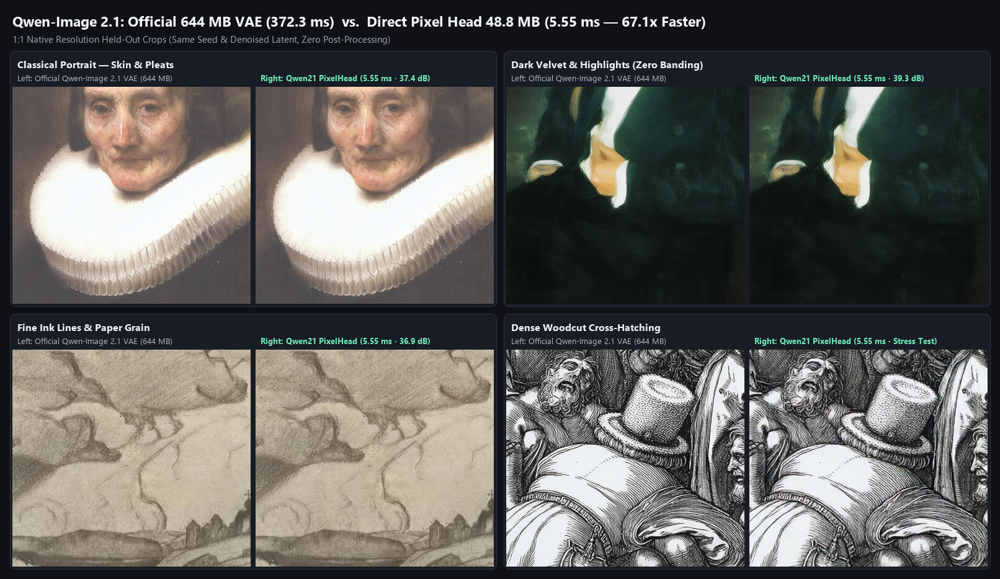
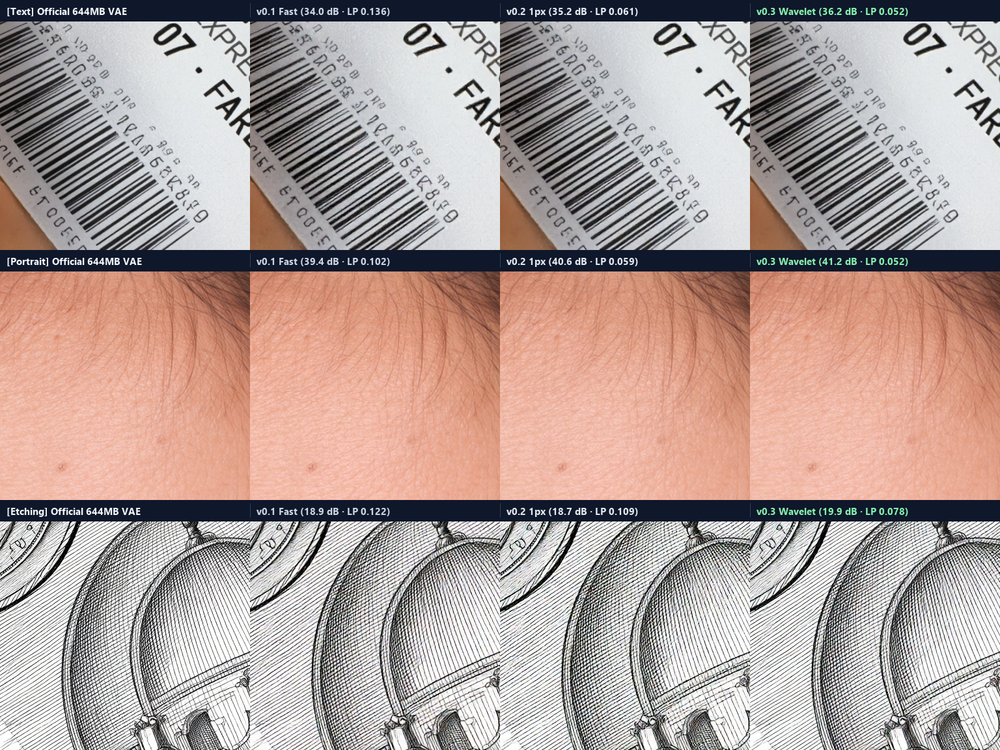

# FastFrames-PixelHead-Trainer

面向 ComfyUI 扩散模型（2D 图像与 3D 视频 DiT）的免 VAE 像素直出头（Direct Pixel Head）训练代码、各底座源码挂载整理及单卡 Colab L4/A100 训练脚本。

[English](README.md) | [简体中文](README_zh.md) | [新模型适配流程与踩坑记录 (ZH)](docs/PLAYBOOK_ADAPTING_NEW_MODELS_ZH.md) | [Adaptation Notes & Post-Mortems (EN)](docs/PLAYBOOK_ADAPTING_NEW_MODELS_EN.md)

[](LICENSE)
[](https://huggingface.co/collections/pocis/fastframes-zero-vae-direct-pixelheads-comfyui-6b031df8e9212f8bae294154)

## 1. 项目背景

主流流匹配扩散模型（DiT）在最后一层线性映射（`proj_out / linear`）之前拥有 `3072～6144` 维的逐 Token 特征，传统管线先将其压缩到 `16～128` 通道潜空间，再调用几百 MB 到数 GB 的 2D/3D VAE 解码器还原成图像或视频，高分辨率出图时也经常在最后一步 `VAEDecode` 爆显存。

本项目衍生并扩展自原作者 **[Seunghyun Ji (`sorryhyun`)](https://huggingface.co/sorryhyun)** 在 **[`sorryhyun/anima_lora`](https://github.com/sorryhyun/anima_lora)**、**[`sorryhyun/anima_pixel_decoder`](https://huggingface.co/sorryhyun/anima-pixel-decoder)** 与 **[`sorryhyun/ComfyUI-Anima-PixelDecoder`](https://github.com/sorryhyun/ComfyUI-Anima-PixelDecoder)**（MIT License，`Copyright (c) 2026 Seunghyun Ji`）中提出的像素头架构、ComfyUI `Tap + Decode` 范式及单步 `ReplayBuffer` / 小波对抗蒸馏管线，并结合 Apple Research 论文 [*FastFrames* (`arXiv:2611.23226`)](https://arxiv.org/abs/2611.23226) 的直接像素读出框架，适配了 5 个主流 ComfyUI 扩散底座与单卡 Colab L4/A100 训练脚本：

- 在 `16×16` 像素/Token 的 **2D 图像模型**上，`48.8～79.3 MiB`（BF16）的像素头可将解码耗时缩短 `17.9～86.4` 倍（其中 **`Qwen-Image 2.1 v0.3` 小波高保真版**在 L4 `1024²` 下耗时 `37.51 ms`、均值 `33.81 dB`、`LPIPS 0.0736`；`v0.1` 快速版耗时 `5.55～7.77 ms`；**`Krea-2`** 耗时 `59.55 ms`、均值 `33.33 dB`），并支持二阶 `2x`（`1024 → 2048`）一步放大输出。
- 在单 Token 覆盖 `4×32×32` 甚至 `8×32×32` 像素的 **高压缩比 3D 视频模型**（如 `MiniMax-H3`）上，实测如果只用纯像素空间 `MSE` 训练，虽然解码速度快 `8.5` 倍，但复杂自然纹理会出现明显的平滑涂抹感——相关原因与改进方向均已如实记录在 [docs/PLAYBOOK_ADAPTING_NEW_MODELS_ZH.md](docs/PLAYBOOK_ADAPTING_NEW_MODELS_ZH.md) 中。

| `Qwen-Image 2.1`（`5.55 ms`，`67.1×`，均值 `33.91 dB`，4 通道 RGBA） | `Krea-2`（`59.55 ms`，`24.7×`，均值 `33.33 dB`，`6144d` 降维桥） |
| :---: | :---: |
|  |  |

## 2. 底座适配状态与已发布仓库

不同 DiT 底座的末层特征空间互不兼容，需要分别训练。已发布的模型权重汇总在 [Hugging Face 合集页](https://huggingface.co/collections/pocis/fastframes-zero-vae-direct-pixelheads-comfyui-6b031df8e9212f8bae294154)：

| 底座模型 | 模态规格 | 训练脚本 (`notebooks/`) | ComfyUI 节点仓库 | Hugging Face 权重 | 当前状态与实测数据（L4） |
| :--- | :---: | :--- | :--- | :--- | :--- |
| **Qwen-Image 2.1 (`v0.3` 小波版)** | 2D RGBA (`1x` Haar 小波) | [`07_Train_QwenImage21...v03...ipynb`](notebooks/07_Train_QwenImage21_PixelHead_v03_Colab_A100.ipynb) | [Wither033/ComfyUI-QwenImage21-PixelHead](https://github.com/Wither033/ComfyUI-QwenImage21-PixelHead) | [pocis/Qwen-Image-2.1-PixelHead](https://huggingface.co/pocis/Qwen-Image-2.1-PixelHead) | 可正常使用 · **`37.51 ms` (`17.9×`)，`33.81 dB`，`LPIPS 0.0736`**，`79.3 MiB` BF16 |
| **Qwen-Image 2.1 (`v0.1` / `v0.2`)** | 2D RGBA (`1x` & `2x`) | [`01_...L4.ipynb`](notebooks/01_Train_QwenImage21_PixelHead_Colab_L4.ipynb) / [`06_...v02.ipynb`](notebooks/06_Train_QwenImage21_PixelHead_v02_Colab_A100.ipynb) | [Wither033/ComfyUI-QwenImage21-PixelHead](https://github.com/Wither033/ComfyUI-QwenImage21-PixelHead) | [pocis/Qwen-Image-2.1-PixelHead](https://huggingface.co/pocis/Qwen-Image-2.1-PixelHead) | 可正常使用 · `v0.1`：`7.77 ms` (`86.4×`)，`48.8 MiB`；`v0.2`：`115.05 ms`，`78.5 MiB` |
| **Krea-2** | 2D RGB (`1x` & `2x`) | [`02_Train_Krea2...ipynb`](notebooks/02_Train_Krea2_PixelHead_Colab_L4.ipynb) | [Wither033/ComfyUI-Krea2-PixelHead](https://github.com/Wither033/ComfyUI-Krea2-PixelHead) | [pocis/Krea-2-PixelHead](https://huggingface.co/pocis/Krea-2-PixelHead) | 可正常使用 · `59.55 ms` (`24.7×`)，`33.33 dB`，`52.6 MiB` BF16 |
| **FLUX.3-Image-Klein** | 2D RGB (`1x` & `2x`) | [`03_Train_Flux3Klein...ipynb`](notebooks/03_Train_Flux3Klein_PixelHead_Colab_L4.ipynb) | [`comfyui_nodes/ComfyUI-Flux3-PixelHead`](comfyui_nodes/ComfyUI-Flux3-PixelHead) | 暂未跑训练 | 代码与训练脚本已备好（`24.41M` 参数，`46.6 MiB` BF16） |
| **LTX-2.5** | 3D 视频 (`8*T-7` 因果) | [`04_Train_LTX25_Video...ipynb`](notebooks/04_Train_LTX25_VideoPixelHead_v2_Colab_L4.ipynb) | [`comfyui_nodes/ComfyUI-LTX25-PixelHead`](comfyui_nodes/ComfyUI-LTX25-PixelHead) | 暂未跑训练 | `v2` 过完备脚本已备好（`23.87M` 参数，`2.67×` 过完备） |
| **MiniMax-H3** | 3D 视频 (`(1,4,4,4,4)` 因果) | [`05_Train_MiniMaxH3_Video...ipynb`](notebooks/05_Train_MiniMaxH3_VideoPixelHead_v2_Colab_L4.ipynb) | [Wither033/ComfyUI-MiniMaxH3-PixelHead](https://github.com/Wither033/ComfyUI-MiniMaxH3-PixelHead) | [pocis/MiniMax-H3-Video-PixelHead](https://huggingface.co/pocis/MiniMax-H3-Video-PixelHead) | 实验预览版（`v0.2.0`，复杂纹理偏糊，不推荐正式使用） |

## 3. 核心原理与结构要点

### 3.1 为什么同时输入 `f`（末层调制特征）与 `x0_hat_norm`（去噪潜变量）

流匹配 DiT 的末层线性映射输出速度场 $v = W f + b$，最后一步估算出的干净潜变量为：

$$\hat{x}_0 = x_t - \sigma_{\text{last}} \cdot v$$

1. **挂载位置（`AdaLN` 调制之后、最终 `linear / proj_out` 之前）**：在此处挂 `register_forward_pre_hook`（钩子函数不能有非 `None` 返回值），即可拿到未压缩的高维空间特征 $f$。
2. **线性兼容 CFG**：由于挂点在线性层之前，开启 `CFG > 1`（尺度 $g$）时，对正负向特征做线性组合：
   $$f_{\text{cfg}} = f_u + g \cdot (f_c - f_u)$$
   与引导后的速度场 $v_{\text{cfg}}$ 在数学上一致，因此同一份权重可同时用于 `CFG = 1.0` 的蒸馏模型和 `CFG > 1.0` 的常规模型。
3. **拼入 `x0_hat_norm` 消除步数差异**：单靠速度特征 $f$ 缺少起点 $x_t$ 信息，且数值随采样步数变化较大；把 `LayerNorm(f)` 降维后与 `x0_hat_norm` 相加归一化，PSNR 可提升 `6 dB` 以上，也能让同一权重跨步数共用。

### 3.2 结构与训练中的几个关键细节

1. **不要加 `f -> RGB` 的线性直通残差**：实验表明加直接线性跳连会让 PSNR 卡在 `26.5 dB` 左右，全部走 ConvNeXt + PixelShuffle 主干才能收敛到 `33 dB` 以上。
2. **用无偏置线性桥控制体积**：高维底座（`4096～6144` 维）先过 `Linear(d_feat -> width, bias=False)` 降维，BF16 权重即可保持在 `45～53 MiB`。
3. **末层投影保持过完备**：在进入最后一层 `out_proj` 前，尽量通过多级 `2× PixelShuffle` 让特征通道数 `w_final` 大于输出维度 `out_dim` 的 `2.5` 倍以上。对于 `32×32` 像素/Token 的 3D 视频模型，需要做三级上采样下探到 `4×4` 网格（`256 → 96` 或 `256 → 48`），避免停在 `8×8` 网格形成 `256 → 1536` 的线性降秩瓶颈。
4. **末层 `out_proj` 固定使用 `FP32`**：主干可用 `BF16` 加速，但最后一层 `Linear -> RGB` 需关闭 autocast 保持 `float32`，否则暗部和平滑渐变会出现 `1～2` 个色阶的量化断层。
5. **用 `TeacherVAE.decode(x0_hat)` 作为监督目标**：单步去噪得到的 $\hat{x}_0$ 已损失一部分被噪声掩盖的极高频信息，直接拿原图监督会迫使小网络输出模糊均值；拟合官方 VAE 对同一 $\hat{x}_0$ 的解码输出更稳定。

### 3.3 兼顾微距锐度与低延迟的小波架构演进（`Qwen-Image 2.1 v0.1 → v0.2 → v0.3`）

针对 `1024×1024` 近景人像毛孔、斜排票据细字与 `1px` 铜版交叉排线，`v0.3`（[`07_Train_QwenImage21_PixelHead_v03_Colab_A100.ipynb`](notebooks/07_Train_QwenImage21_PixelHead_v03_Colab_A100.ipynb)，单张 24GB L4 可跑完）做了三点改进：
1. **2D Haar 小波四子带直出 + 解析 `iDWT`**：避开 `v0.2` 在 `1024×1024` 全图跑 `GroupNorm + 逐通道卷积` 的带宽瓶颈，在 `512×512` 小波网格用无归一化融合卷积预测 `(LL, LH, HL, HH)`，L4 耗时比 `v0.2` 快 **`3.07×`**（`115.05 ms → 37.51 ms`），激活显存下降 **`44.2%`**（`904 MiB → 504 MiB`）；
2. **多尺度潜空间 `3×3` 空间直通桥（`LatentSpatialHighway`）**：对 `64` 通道 `x0_hat_norm` 做跨 Token 的 `3×3` 空间卷积并注入 `8px`、`4px`、`2px` 层，补齐跨块斜线连续性；
3. **锁死低频 `LL.detach()` 的高频小波 PatchGAN**：判别器仅约束高频子带 `(LH, HL, HH)` 不动底色，使留出集 `LPIPS-VGG` 从 `0.1272 → 0.0808 → 0.0736` 持续下降的同时，总体 `PSNR` 同步升至 **`33.81 dB`**（人像子集均值 `39.17 dB`）。



详细的新模型排查步骤与开发过程中遇到的 6 个具体问题见 [docs/PLAYBOOK_ADAPTING_NEW_MODELS_ZH.md](docs/PLAYBOOK_ADAPTING_NEW_MODELS_ZH.md)。

## 4. ComfyUI 五个底座源码挂点对照表

| 底座模型 | ComfyUI 源码路径 | Pre-Hook 挂载模块 | `d_feat` | `d_lat` | 单 Token 像素范围 | 序列切片与调度注意事项 |
| :--- | :--- | :--- | :---: | :---: | :---: | :--- |
| **Qwen-Image 2.1** | `comfy/ldm/qwen_image21/model.py` | `diffusion_model.proj_out` | `4096` | `64` | `16×16` RGBA | `norm_out(hidden_states[:, prefix_len:])` 在进 `proj_out` 前已切掉文本与参考图前缀。 |
| **Krea-2** | `comfy/ldm/krea2/model.py` | `diffusion_model.last.linear` | `6144` | `16×2×2=64` | `16×16` RGB | 单流序列 `[txt, target_img, ref_img]` 一起进 `last.linear`，需按 `txtlen = seq - img - ref` 切片。 |
| **FLUX.3-Klein** | `comfy/ldm/flux3/model.py` | `final_layer["image"].linear` | `3072` | `128` | `16×16` RGB | 前向需在 `transformer_options` 传入 `sample_sigmas=[sigma, 0.0]` 以匹配 FlowMap 末步逻辑。 |
| **LTX-2.5** (`v2`) | `comfy/ldm/lightricks/av_model.py` | `diffusion_model.proj_out` | `4096` | `128` | `8t × 32×32` RGB | 从音画 `NestedTensor` 取第 `0` 项视频流；三级重排后去掉前 7 帧因果预热帧（`8*T_lat - 7`）。 |
| **MiniMax-H3** (`v2`) | `comfy/ldm/minimax/model.py` | `diffusion_model.final_layer` | `5376` | `24×1×2×2=96` | `(1,4,4,4,4)t × 32×32` | 8 步 PDD 模型直接调 `F.linear` 绕过了 `video_out.forward`，需挂在 `final_layer` 入口复算 `mod(video_seg)`。 |

## 5. 单卡 Colab L4（24GB）三段式训练流程

[`notebooks/`](notebooks/) 下的脚本均按三个步骤组织：

1. **离线缓存潜变量与文本条件（约 6～10 分钟）**：用官方 VAE 和文本编码器把校准样本编码存到本地 NVMe，随后卸载 `8B～32B` 文本编码器释放显存，使训练阶段显存保持在 `9～16 GB`。
2. **开训前等变性与 P0 冒烟检查（约 10 秒）**：用异形长宽比张量检查裁剪平移等变性（误差 `< 1e-5`）与长视频分块解码一致性（`decode_chunked == forward`），再跑 90 步快速拟合确认 PSNR 正常爬升（涨幅 `>= +6 dB`）。
3. **单步加噪 + Replay Buffer 训练（约 25～45 分钟）**：交替抽样蒸馏模型与常规多步模型的末步 $\sigma_{\text{last}}$，每次跑 1 遍冻结 DiT 前向，将 `(f, x0_hat_norm, TeacherVAE.decode(x0_hat))` 放入容量 `64` 的重放池中更新 PixelHead `12～16` 步：
   $$\mathcal{L}_{2\text{D}} = 0.5\,\mathcal{L}_1 + 5.0\,\text{MSE} + 0.05\,(\mathcal{L}_{\nabla_h} + \mathcal{L}_{\nabla_w})$$
   （3D 视频头额外加上帧间差分与运动区域加权项；对于 `32×32` 高压缩比视频头，后续还需补充 `LPIPS-VGG` / 频域损失以解决高频涂抹问题）。

## 6. 本地 CPU 单元测试

无需 GPU 即可测试通用模块与 5 个底座像素头的维度、裁剪等变性、因果分块及权重导出逻辑：

```bash
pip install -e .
CUDA_VISIBLE_DEVICES="" python tests/test_all_heads_and_gates.py
```

## 7. 原作者署名、致谢与开源协议


- **原作者与核心管线致谢**：本项目的像素头核心结构、ComfyUI `Tap + Decode` 挂载范式及训练管线（包括无跳连 ConvNeXt + `2× PixelShuffle` `1x/2x` 解码结构、末层线性映射前 `f_u + g·(f_c - f_u)` 特征截获与潜变量块融合、基于 `VAE(x̂0)` 的跨 Base/Turbo 单步 `ReplayBuffer` 蒸馏、RGBA 四通道读出，以及 `v0.3` 的 2D Haar 小波子带预测与锁定低频 `LL` 的高频对抗训练思路）衍生并改编自原作者 **[Seunghyun Ji (`sorryhyun`)](https://huggingface.co/sorryhyun)**（[GitHub `@sorryhyun`](https://github.com/sorryhyun)）在 **[`sorryhyun/anima_lora`](https://github.com/sorryhyun/anima_lora)**、**[`sorryhyun/anima_pixel_decoder`](https://huggingface.co/sorryhyun/anima-pixel-decoder)** 与 **[`sorryhyun/ComfyUI-Anima-PixelDecoder`](https://github.com/sorryhyun/ComfyUI-Anima-PixelDecoder)** 中的开创性开源工作（MIT License，`Copyright (c) 2026 Seunghyun Ji`）。特此向原作者 `sorryhyun` 致谢！
- **基础论文参考**：直接像素读出（Direct Pixel Readout）理论框架参考 [*FastFrames: Video Generation at Interactive Latency* (`arXiv:2611.23226`)](https://arxiv.org/abs/2611.23226)（Gene Chou et al., Apple & Cornell, 2026）。
- **开源协议**：[MIT License](LICENSE)（完整保留原作者 `Copyright (c) 2026 Seunghyun Ji` 版权声明；配合各扩散底座模型使用时请同时遵守对应底模的许可证条款）。
